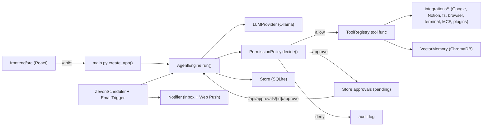

# Zevon AI code map (read this instead of the whole repo)
Generated structure also lives in `graphify-out/` (`graph.html` = visual graph, `GRAPH_REPORT.md` = summary, `graph.json` = queryable).
Query it: `graphify query "<question>"` · `graphify explain "<Class or function>"` · `graphify path "A" "B"` · `graphify affected "X"`.
After code changes: `graphify update .` (local, no LLM, no cost).

## Request flow

## Where things live (backend/app/)
| File | Responsibility |
|---|---|
| `main.py` | `create_app()`: wires everything; ALL HTTP endpoints; CORS; serves `frontend/dist` |
| `config.py` | `Settings` dataclass, every `ZEVON_*` env var, `.env` loader |
| `core/agent_engine.py` | `AgentEngine`: `run_stream` (events: plan/token/tool/done), planning, rolling summary, loop guard, `_execute` (permission check), `approve()`/`deny()` |
| `core/permissions.py` | `PermissionPolicy`, `Decision`, risk→decision table, kill switch |
| `core/tools.py` | `Tool`, `ToolRegistry`, global `registry`, `@registry.tool(...)` decorator |
| `core/llm.py` | `LLMProvider` (chat + chat_stream), `OllamaProvider`, `OpenAICompatProvider` (llama.cpp/vLLM/cloud), `AnthropicProvider`, `ThinkFilter`, `make_provider` |
| `core/memory.py` | `Store`: all SQLite tables (messages, memories, instructions, approvals, audit, notifications, seen, push_subs) |
| `core/memory_tools.py` | `memory_remember` / `memory_recall` tools |
| `core/vector_memory.py` | `VectorMemory` (ChromaDB), `OllamaEmbedder` |
| `core/notify.py` | `Notifier`: in-app notification + Web Push (VAPID) + Android FCM |
| `core/fcm.py` | Firebase Cloud Messaging sender |
| `core/voice.py` | faster-whisper STT, Piper TTS (lazy) |
| `scheduler/runner.py` | `ZevonScheduler`: cron instructions + interval jobs |
| `triggers/__init__.py` | trigger string patterns (`valid_trigger`, `TRIGGER_HELP`) |
| `triggers/base.py` | `RuleTrigger`: generic poll -> baseline -> fire rule -> notify |
| `triggers/sources.py` | `CalendarTrigger`, `FileTrigger`, `SlackTrigger`, `TimeTrigger` |
| `triggers/email_trigger.py` | `EmailTrigger` (`email:new`) |
| `integrations/__init__.py` | `load_all()`: which built-in extensions register |
| `integrations/system/filesystem.py` | `safe_path` sandbox + fs tools |
| `integrations/tools/terminal.py` | allowlisted terminal (`ALLOW` dict) |
| `integrations/tools/browser.py` | `check_url` SSRF guard + page reader |
| `integrations/google/{auth,gmail,youtube,calendar,drive,tasks}.py` | Google tools; `auth.SCOPES` |
| `integrations/productivity/{notion,todoist,slack}.py` | third-party tools (enabled by token) |
| `integrations/mcp_client.py` | MCP servers → tools (`data/mcp_servers.json`) |
| `integrations/plugin_loader.py` | loads `plugins/*/plugin.py` |

Frontend (`frontend/src/`): `api.js` (server URL/token, fetch, `streamChat`), `sse.js`, `voice.js` (wake word + VAD, pure), `handsfree.js` (continuous listening), `rules.js` (trigger strings), `native.js` (Android FCM, desktop notifications), `App.jsx` (tabs, badges, kill switch), `components/` Chat (sessions, streaming, plan, mic/hands-free), Approvals, Inbox, Rules (toggle + all triggers), Memory (CRUD), Permissions (per-tool policy), Lists (Audit), Settings. Tests: `frontend/tests/frontend.test.mjs` (`npm test`). Android = `frontend/android` (Capacitor), desktop = `frontend/src-tauri`.
Tests: `backend/tests/test_core.py` (agent, approvals, sandbox), `test_ollama_scheduler.py`, `test_v2.py` (connectors, MCP, vector, push), `test_v3.py` (streaming, providers, sessions, planning, policies, triggers), `test_service.py`. Scripts: `scripts/install_service.py`, `generate_icons.py`, `google_auth.py`, `setup_graphify.sh`, `push_to_github.sh`.

## Recipes (touch only these files)
- **New tool:** add function + `registry.tool(...)` in an `integrations/**` module (or `plugins/<name>/plugin.py`); if built-in, register in `integrations/__init__.py`. Choose `risk`. Add a test in `test_v2.py`.
- **New API endpoint:** `main.py` inside `create_app()` (add `dependencies=[api]`); add a call in `frontend/src/components/*`; document in `docs/api.md`.
- **New env setting:** `config.py` (`Settings`) + `.env.example`.
- **New DB table/column:** `core/memory.py` `SCHEMA` + a `Store` method.
- **New trigger type:** subclass `RuleTrigger` in `triggers/sources.py`, add its pattern to `triggers/__init__.py`, instantiate it in `main.py` (`other_triggers`), add to `frontend/src/rules.js` + `Rules.jsx`.
- **New LLM backend:** subclass `LLMProvider` in `core/llm.py` (implement `chat`, optionally `chat_stream`; set `local`), add to `make_provider`.
- **Per-tool permission UI:** `/api/policies` in `main.py` + `Permissions.jsx`; overrides live in table `tool_policies`.
- **Change what needs approval:** the tool's `risk=` (or `PermissionPolicy.overrides`).
- **New UI tab:** component in `frontend/src/components/`, add to `TABS` in `App.jsx`.

## Invariants (don't break)
1. Tools never run unless `PermissionPolicy.decide` allows; sensitive → approval queue.
2. Tool output is wrapped in `<untrusted_data>`; external content never goes straight into the user role.
3. File/URL/command arguments are validated inside the tool (`safe_path`, `check_url`, terminal allowlist).
4. Optional dependencies are imported lazily and degrade gracefully.
